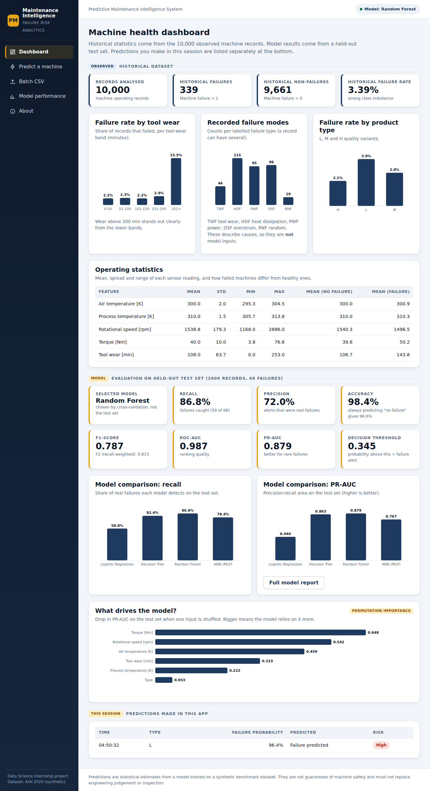
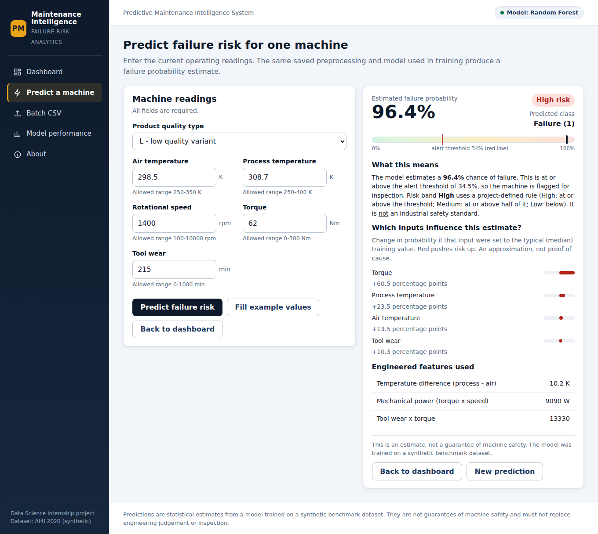
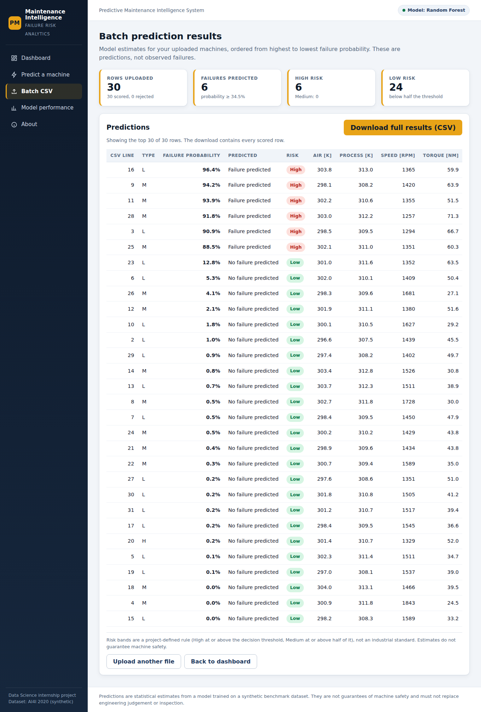
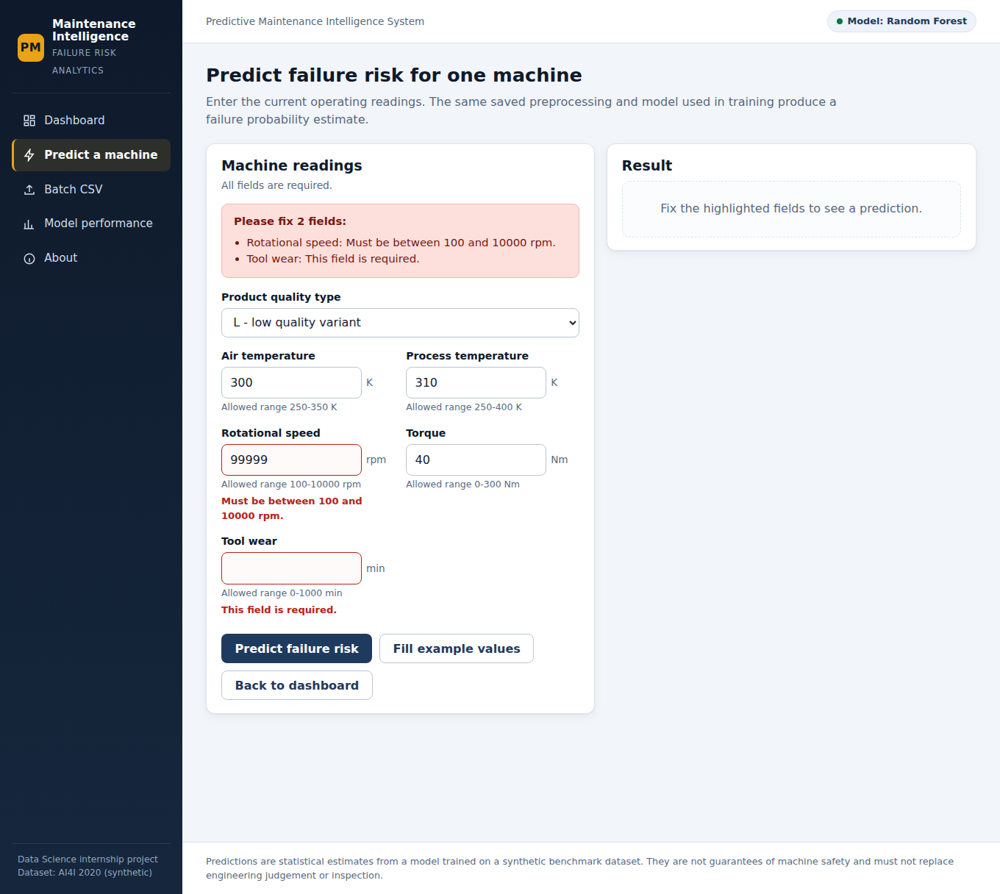
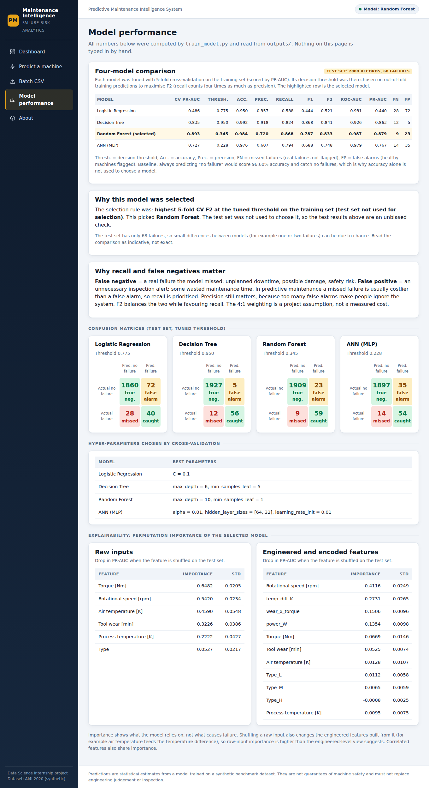
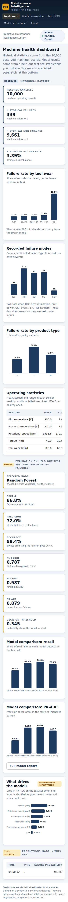
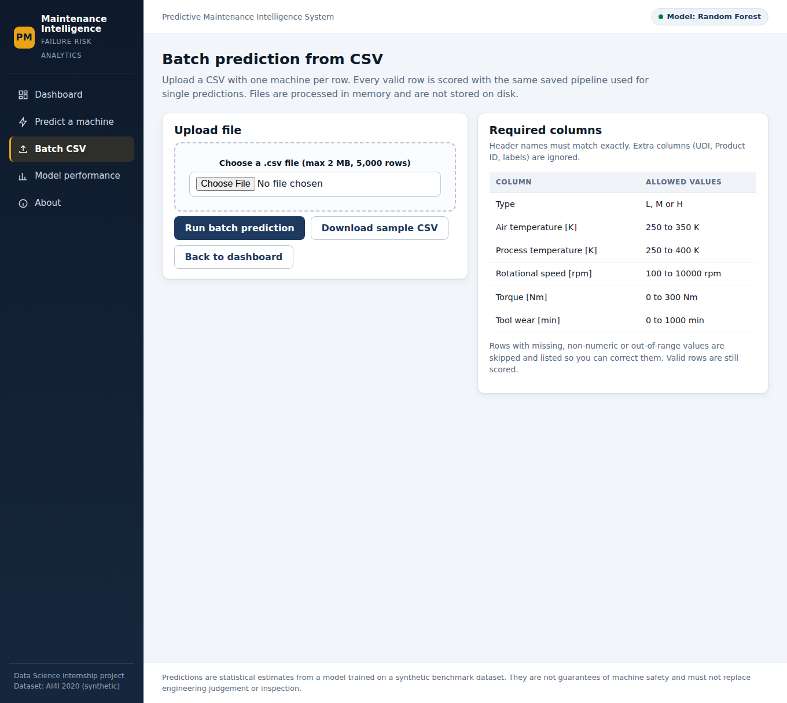

# Predictive Maintenance Intelligence System

Machine learning and Flask web application that estimates the probability of machine failure from operating conditions.
Built as a Data Science internship project on the AI4I 2020 Predictive Maintenance dataset.



## Table of contents
1. [Problem statement](#problem-statement) 2. [Dataset](#dataset) 3. [Methodology](#methodology) 4. [Model comparison](#model-comparison-actual-results) 5. [Project structure](#project-structure) 6. [Setup](#setup) 7. [Training](#train-the-model) 8. [Run the app](#run-the-web-application) 9. [Using the app](#using-the-app) 10. [Tests](#run-the-tests) 11. [Screenshots](#screenshots) 12. [Publish to GitHub](#publish-to-github) 13. [Troubleshooting](#troubleshooting) 14. [Limitations](#limitations) 15. [Future improvements](#future-improvements)

## Problem statement
Unplanned machine failures cause downtime and damage. The goal is a system that analyses machine operating conditions and sensor readings to identify machines at risk of failure, with a trained ML model behind a user-friendly Flask web application.

**Business view of errors.** A *false negative* (missed failure) is usually costlier than a *false positive* (unnecessary inspection), so the final model is chosen for its ability to catch failures while keeping false alarms reasonable, not for accuracy alone.

## Dataset
`data/ai4i2020.csv` (provided by the mentor): 10,000 machine records, 14 columns, **no missing values and no duplicates**.
It is a **synthetic** benchmark dataset, so results do not automatically transfer to real machines.

| Column(s) | Role |
|---|---|
| `Type` (L/M/H), `Air temperature [K]`, `Process temperature [K]`, `Rotational speed [rpm]`, `Torque [Nm]`, `Tool wear [min]` | **Model inputs** |
| `Machine failure` | **Target** (1 = failure) |
| `TWF`, `HDF`, `PWF`, `OSF`, `RNF` | Failure-mode flags, **excluded** (leakage) |
| `UDI`, `Product ID` | Identifiers, **excluded** |

Class imbalance: **339 failures (3.39%)** versus 9,661 non-failures.

## Methodology
1. **EDA** (notebook): data quality, target imbalance, univariate and multivariate analysis, outliers, correlation; 10 visualizations, each with insights.
2. **Leakage control.** 330 of 339 failures carry a failure-mode flag, so the five flags effectively contain the answer and are not known before a failure; they are excluded. Identifiers are excluded too. Only `Type` and the five sensor readings are inputs.
3. **Feature engineering** (`core.add_features`): `temp_diff_K` = process - air temperature, `power_W` = torque x angular speed, `wear_x_torque` = tool wear x torque.
4. **Preprocessing** (inside one scikit-learn `Pipeline`, so it is fitted on training data only): standard scaling of numeric features, one-hot encoding of `Type`.
5. **Split:** stratified 80/20 (`random_state=42`): 8,000 training and 2,000 test records (68 test failures).
6. **Four models,** each tuned with 5-fold stratified `GridSearchCV` scored by PR-AUC:
- **Logistic Regression**: `C=0.1`
- **Decision Tree**: `max_depth=6`, `min_samples_leaf=5`
- **Random Forest**: `max_depth=10`, `min_samples_leaf=1`
- **ANN (MLP)**: `alpha=0.01`, `hidden_layer_sizes=[64, 32]`, `learning_rate_init=0.01`
7. **Imbalance handling:** class weights for Logistic Regression, Decision Tree and Random Forest; the MLP (no class-weight option) relies on threshold tuning. For every model the **decision threshold** is chosen on out-of-fold *training* predictions to maximise **F2** (recall weighted 4x precision; the 4:1 weighting is an assumption that missed failures cost more than false alarms).
8. **Selection** uses training cross-validation only (highest CV F2 at the tuned threshold, PR-AUC as tie-break); the **test set is used once, for reporting**.
9. **Explainability:** permutation importance on the test set (raw inputs and engineered features).

## Model comparison (actual results)
Test set: 2,000 records, 68 failures, each model at its own tuned threshold. Produced by `train_model.py` (`outputs/model_comparison.csv`).

| Model | CV PR-AUC | Threshold | Accuracy | Precision | Recall | F1 | F2 | ROC-AUC | PR-AUC | Missed (FN) | False alarms (FP) |
|---|---|---|---|---|---|---|---|---|---|---|---|
| Logistic Regression | 0.486 | 0.775 | 0.950 | 0.357 | 0.588 | 0.444 | 0.521 | 0.931 | 0.440 | 28 | 72 |
| Decision Tree | 0.835 | 0.950 | 0.992 | 0.918 | 0.824 | 0.868 | 0.841 | 0.926 | 0.863 | 12 | 5 |
| Random Forest **(selected)** | 0.893 | 0.345 | 0.984 | 0.720 | 0.868 | 0.787 | 0.833 | 0.987 | 0.879 | 9 | 23 |
| ANN (MLP) | 0.727 | 0.228 | 0.976 | 0.607 | 0.794 | 0.688 | 0.748 | 0.979 | 0.767 | 14 | 35 |

**Selected model: Random Forest.** On the held-out test set it catches 59 of 68 failures (recall 0.868) with 23 false alarms (precision 0.720); ROC-AUC 0.987, PR-AUC 0.879.
Always predicting "no failure" would score 96.6% accuracy while catching nothing, which is why accuracy is not the selection criterion.

**Read with care:** the test set has only 68 failures, so the Decision Tree and Random Forest are statistically close (the Decision Tree has fewer false alarms and a slightly higher test F2). Random Forest was selected by cross-validation on the training data, before looking at the test set. Logistic Regression performs clearly worst because failures depend on thresholds and interactions that a linear model cannot represent.

**Risk categories (project-defined, not an industry standard):** High = probability at or above the decision threshold (0.345); Medium = at or above half of it; Low = below.

## Project structure
```
predictive-maintenance-system/
|-- app.py                 Flask application (loads the saved model, never retrains)
|-- core.py                Shared schema, feature engineering, validation, risk bands, Predictor
|-- train_model.py         Trains, tunes, evaluates, saves model + metrics
|-- requirements.txt
|-- README.md
|-- REQUIREMENTS_CHECKLIST.md   Mentor requirement -> implementation map
|-- data/ai4i2020.csv
|-- notebooks/predictive_maintenance_eda.ipynb
|-- models/predictive_maintenance_model.joblib   fitted pipeline + threshold + metadata
|-- outputs/               model_comparison.csv, evaluation_metrics.json, feature_importance.csv, dataset_stats.json
|-- templates/             base, index (dashboard), predict, batch_predict, results, model_performance, about, error
|-- static/                css/style.css, js/charts.js, sample_batch.csv
|-- tests/                 test_preprocessing.py, test_predictions.py, test_app.py
|-- docs/                  PROJECT_EXPLANATION.md, screenshots/
```
`core.py` is imported by both training and the app, so feature engineering and validation cannot drift apart.

## Setup
Requires **Python 3.11+** (built and tested on 3.12.3).
```bash
git clone <your-repository-url>
cd predictive-maintenance-system
python -m venv venv
# Windows:   venv\Scripts\activate
# macOS/Linux: source venv/bin/activate
pip install -r requirements.txt
```

## Train the model
A trained model is already included in `models/`. To retrain (about 2-3 minutes on one CPU core):
```bash
python train_model.py
```
This rewrites the model file and everything in `outputs/`. Results are reproducible (`random_state=42`) for the pinned library versions.

## Run the web application
```bash
python app.py
```
Open http://127.0.0.1:5000. (To use another port: set the `PORT` environment variable.)

## Using the app
- **Dashboard:** historical statistics (observed), model results (held-out test set) and your session predictions, clearly separated. With no predictions yet it shows an empty state.
- **Predict a machine:** fill the six fields (or click *Fill example values*) and submit. You get the predicted class, the failure probability, the risk band, an explanation, engineered feature values and a what-if analysis of which inputs matter. Invalid, missing or out-of-range values are rejected with field-level messages.
- **Batch CSV:** upload a `.csv` (max 2 MB, 5,000 rows) with the columns `Type, Air temperature [K], Process temperature [K], Rotational speed [rpm], Torque [Nm], Tool wear [min]`. Use *Download sample CSV* for a ready file. Valid rows are scored, bad rows are listed with their CSV line number, and you can download all results as CSV. Uploads are processed in memory and never saved to disk.
- **Model performance:** four-model table, confusion matrices, hyper-parameters, permutation importance and the selection rationale, all read from `outputs/`.

## Run the tests
```bash
python -m unittest discover -s tests -t . -v
```
38 tests cover preprocessing, leakage safeguards, validation, model loading, single and batch predictions, and every route including invalid input, missing columns, empty and oversized files. (`pytest` also works if installed.)

## Screenshots
| | |
|---|---|
|  Prediction result |  Batch results |
|  Validation errors |  Model performance |
|  Mobile view |  CSV upload |

Further screenshots are in `docs/screenshots/`. They were captured without internet access, so Bootstrap from the CDN was not loaded; `style.css` styles every Bootstrap class used, so the app looks the same with or without it.

## Publish to GitHub
1. Create a new empty repository on github.com (no README or .gitignore, since the project already has them).
2. In the project folder:
```bash
git init
git add .
git commit -m "Predictive maintenance intelligence system"
git branch -M main
git remote add origin https://github.com/<your-username>/<your-repository>.git
git push -u origin main
```
3. Check on GitHub that `models/predictive_maintenance_model.joblib` (about 1 MB) and `outputs/` were uploaded; they are needed to run the app without retraining.

## Troubleshooting
| Problem | Fix |
|---|---|
| `FileNotFoundError: Model artifact not found` | Run `python train_model.py` first. |
| Warning or error loading the `.joblib` file | scikit-learn version differs from the one in `requirements.txt`; install the pinned version or retrain. |
| `ModuleNotFoundError: core` | Run commands from the project root folder. |
| `Address already in use` | Use `PORT=5001 python app.py` (macOS/Linux) or `set PORT=5001` first (Windows). |
| Upload rejected | Check the header names exactly match, the file is `.csv`, under 2 MB and 5,000 rows, saved as UTF-8. |
| Page unstyled / no charts | Charts and styling are local files; make sure `static/` was not deleted. |

## Limitations
- **Synthetic data:** the dataset was generated from rules, so real-world performance would be lower and noisier.
- **Few failures** (339 in total, 68 in the test set): metrics are uncertain and model differences can be due to chance.
- Probabilities are **estimates**, not calibrated guarantees; a "Low" risk does not mean a machine is safe.
- The risk bands and the F2 weighting are project assumptions, not industrial standards or measured costs.
- Inputs outside the training range trigger a warning because the model may extrapolate poorly.
- Session history and batch results live in memory and reset when the server restarts; the app is a single-process development server, not a production deployment.

## Future improvements
Validate on real machine logs; add time-series features; choose the threshold from real downtime and inspection costs; calibrate probabilities and add confidence intervals; per-prediction SHAP explanations; user accounts and a database for prediction history; Docker deployment behind a production WSGI server; monitoring for data drift.
